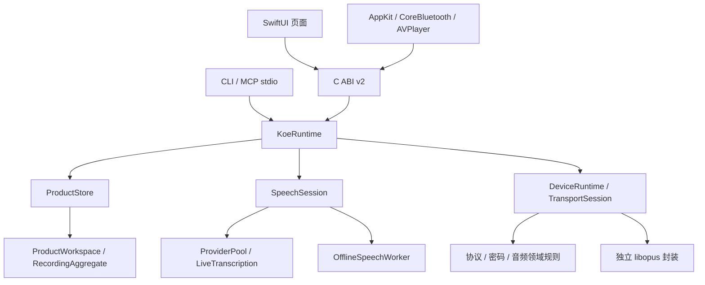

# Koe 架构与状态所有权

Koe 以 Rust 保存领域事实、执行规则和协调处理管线，macOS 宿主负责原生展示与系统 I/O。产品围绕三种阅读方式组织：今天回顾全天记忆，记录详情回到一条记录，全局问答跨记录检索。三者读取同一份工作区事实。三模式工作区业务定义见[业务定义](mode-workspaces.md)；这些页面继续读取同一份Rust工作区，不改变下述状态所有权。

## 分层



箭头表示调用与依赖方向，不表示复制状态。Rust crate 不依赖 SwiftUI、AppKit 或其他 UI 框架。

| 层 | 模块 | 拥有的责任 |
| --- | --- | --- |
| 领域与协议 | `crates/koe-engine/src/product/`、`domain.rs`、`context.rs`、`session.rs`、`hash.rs`、`prng.rs` 等 | 记录聚合、来源解析、审核与处理状态转换、搜索、协议、加密与纯哈希/伪随机工具；零外部依赖，不做文件或网络 I/O |
| 音频编解码边界 | `crates/koe-opus` | 对静态 libopus 的窄安全封装；保持 `OpusStreamDecoder` 接口 |
| 客户端基础与格式 | `koe-client-base` | 原子文件工具与排他文件锁 |
| 存储与传输服务 | `koe-client-services`、`koe-client-providers` | 持久化编解码、文件导入、音频资产、真实 HTTPS/WebSocket、后台网络与本机模型工作线程 |
| 应用编排 | `crates/koe-runtime` | 将 `HostIntent` 与 `AdapterEvent` 分离接入，连接领域事务、设备事件、异步结果和页面投影；选择要处理的记录 |
| 宿主接口与入口 | `koe-host-api`、`koe-cli`、`platforms/` | 仅依赖 `koe-runtime` 的版本化 C ABI、命令行与 MCP、SwiftUI、`HostBridgeActions`、系统窗口和硬件 I/O |

`koe-client-providers` 与 `koe-client-services` 不互相调用，二者由 `koe-runtime` 协调并共用 `koe-engine` 的领域类型与纯底层工具（含 SHA-256、FNV1a、PRNG）。`koe-host-api` 不直接依赖 `koe-engine`、`koe-client-base`、`koe-client-services` 或 `koe-client-providers`。

## 唯一的产品状态

`ProductWorkspace` 持有记录集合、审核项、问答会话和来源关系。每个 `ProductRecord` 持有自己的 `RecordingAggregate`、处理状态和重点片段 ID；聚合内保存 `UtteranceSpine`、纪要和录音元信息。

- 记录 ID 是稳定身份；当前选中的记录是 runtime 的导航状态。
- 设备正在写入的记录与用户正在浏览的记录分别确定。切换页面不能改变音频或转写结果的归属。
- 待办和记忆共用带来源的审核项，状态为 `Proposed`、`Accepted`、`Dismissed`。只有接受后的待办可以完成；编辑展示文字不改写原始证据。
- `SourceRef` 必须同时包含 `record_id` 和 `segment_id`。S1 只在一条记录内唯一，不能单独作为跨记录引用。
- 首页、详情、待办和记忆页是工作区的投影，不各自维护可写副本。

`ProductStore` 是持久状态的所有者。调用方通过 `transact` 对候选状态执行领域操作，序列化和原子保存成功后才发布新状态。音频是独立的不可变资产，不嵌入工作区 JSON，也不随页面投影复制。

默认数据布局：

```text
~/Library/Containers/com.anker.ankerRecorder/Data/Library/Application Support/KoeWorkspace/
  product-workspace.json
  audio/
    <record-id>.wav
    <record-id>.opus
  speech-models/
    <pinned-model>.gguf
```

`ProductStore` 在整个打开期间持有排他文件锁，保证磁盘只有单一写者。`Koe.app` 运行时在容器内监听属主私有的 `.koe/koe.sock`（`0700` 目录、`0600` 套接字与同 UID 校验），CLI 与 MCP 优先经该本地 RPC 共享同一 `KoeRuntime` 会话，应用未运行时再直接获取文件锁。读取失败、未知或损坏的持久格式必须报错并保留原文件；不能以空库覆盖。已有记录的读取兼容同样保留原文件；旧 Flutter 目录导入入口已移除。

## 记录处理管线

### 设备和文件输入

CoreBluetooth 将连接、订阅完成、断开和通知字节交给 Rust，执行 Rust 输出的发送队列；UUID、系统回调与发送背压属于宿主。帧解码、ECDH/AES、离线文件传输和落盘托管规则属于 `TransportSession`。

`DeviceRuntime` 把设备结果交给 runtime。实时录音先建立自己的记录，逐句保存确定文字；最终音频写入并完成持久化后，才确认磁盘托管。文件导入由 `recording_assets` 检查真实格式：WAV 按实际 PCM 计算时长，文字没有虚构的时间偏移，同内容重复导入使用稳定身份。

### Mac 单路麦克风

Runtime 持有一个采集操作，以 `record_id / session_id / microphone / sequence` 绑定所有回调。Swift 的 AVAudioEngine 只选择输入、提供原生采样率的单声道 PCM16 和有效 hostTime 对应的首样本时刻；固定 64 块队列每块最多 8192 样本。队列满或输入格式变化明确停止，不静默丢块后冒充完整录音。停止等待已进入的音频回调完成，再排空已接纳块，Rust 核对最终序号后收尾。

`CaptureAsset` 增量写入 `.capture` 文件。第一次有效音频写入后建立记录，识别结果可在停止前持久保存。封口、音频持久屏障及工作区提交完成后才移除暂存文件。保存失败保留采集所有权并阻止退出，恢复存储后可重试；取消退出不清除待保存音频。权限被拒或空音频不生成成功记录。

暂停会停止生产、等待回调并排空尾块，Rust 确认后才显示已暂停；恢复重新核对权限，以新 epoch 接续原序号，采样率变化明确中断并保留已收音频。启动时恢复具有记录身份的 `.capture` 音频，提交工作区后释放暂存文件；未完成云请求保留中断状态。系统音频双路见下节。系统权限、真实输入切换、回放与签名版退出重开见 [#616](https://github.com/semantic-craft/koe/issues/616)。

### Rust 双路时间轴与暂停协议

双路资产保管仍由同一个 Runtime 会话和 ProductStore 提交。带 `clockNs` 的 `start_microphone` 启用共同单调时钟；每块 `timing` 提供 `epoch` 和实际首样本时刻 `capturedStartNs`，不得用回调到达时间替代。原生开始意图先建立 Rust `starting` 会话，权限完成后通过绑定 `recordId/sessionId/epoch` 的 `microphone_prepared(clockNs)` 确认一次共同基准，再启动采集。权限等待期间仍可取消或退出；旧准备回调不能改变新会话。未带时钟的已有调用保持原契约。

Rust 把各路 WAV 的 `sample_offset/sample_count` 映射到共同活动时间 `start_ns`。原始样本连续保管，时间空隙仅记录在映射中，不补静音或静默裁掉重叠。相邻时刻允许一个样本周期的量化误差并合并连续区间；较大的重叠、超过 10 秒的间隙（含首块）、超过 24 小时的活动时间或超过 4096 个不连续区间会拒绝该块，序号不推进。每块仍限 8192 样本；映射只在字节写入成功后更新，写入重试不重复计时。

`pause_microphone` 进入 `pausing`，仍接收当前代次尾块；各路停止回调生产、排空队列后发送带最终 `sequence/epoch` 的 `microphone_paused`。全部确认才进入 `paused`。`resume_microphone(clockNs)` 以已接受音频的共同末尾作为新活动时间起点，移除暂停间隔并递增 epoch。块和终止/失败事件均受代次约束，带时钟会话的 `microphone_stopped/microphone_failed` 必须携带当前 epoch；旧源迟到回调不能终止恢复后的录音。

活动快照和记录时长由 Rust 输出共同末尾；分路 `durationMs` 仍表示实际样本时长。稀疏时间轴随 `capture_lanes` 经 codec 和工作区重建验证，保存重试及重开后保留。原生单路麦克风已接真实采样时刻和暂停恢复。分路回放由 Rust 输出样本计划，原生执行共同空档与末尾。

### Mac 系统音频双路

录音管理的「同时采集系统音频」开关由 Rust 持有（`set_capture_system_audio`，默认关闭，录音中拒绝切换）。开关打开后，用 Mac 麦克风开始的随心闪记和实时纪要会建立 `microphone` 和 `system` 两路；全天听记和录音豆只录麦克风。任一路授权被拒、启动失败或运行中报错时，Rust 只记录这一路的中断原因，会话继续由其他路录制、暂停/继续和保存，记录显示「采集不完整」；所有路都失败或停止时才收尾整场。磁盘写入失败仍立即停止整场。转写目前只使用麦克风路。

`NativeCapture` 为每路维护独立的有界队列、序号、fence 和暂停/停止屏障。所有请求的权限都有结果后，才确认共同时钟；被拒的路发送 failed 和 stopped，其余路正常启动。取消或退出会中止仍在进行的系统音频授权检测。`NativeSystemAudioSource` 用私有 `CATapDescription` 全局单声道 tap 排除 Koe 自身进程，挂在私有聚合设备上，时钟跟随默认输出设备并开启漂移补偿；按 tap 格式（8–96 kHz 的 Float32/Int16）转为单声道 PCM16，每块不超过 4096 帧，首样本时刻取自 `mHostTime`。默认输出设备、音频服务、设备在线状态、采样率或 tap 格式变化时，这一路明确报错并保留已收音频，不留下静默缺口。系统需为 macOS 14.2 或更高版本。

系统音频授权没有公开的完成回调。[Apple 官方样例](https://developer.apple.com/documentation/coreaudio/capturing-system-audio-with-core-audio-taps)在启动含 tap 的聚合设备时触发授权。Koe 的判据（`NativeSystemAudioProbe`）只使用公开 API：私有全局 tap 加私有聚合设备，接收本进程通过默认输出 AudioUnit 播放的 -100 dBFS Barker-13 检测信号。tap 收到有限的非零样本才算已授权；tap 创建成功、`AudioDeviceStart` 成功或数字静音都不算授权，录屏权限也不能替代系统音频权限。检测信号已渲染、屏幕上没有系统权限弹窗（仅读取 `CGWindowListCopyWindowInfo` 的窗口所属进程名和层级）且 tap 持续返回零值时，才判定拒绝；弹窗期间最多等待 60 秒，弹窗关闭后得出的拒绝会换一个新 tap 再检测一次。检测信号没有渲染或 tap 没有回调时，结果为不可用而非拒绝。签名版的真实授权组合、输出切换和听感验收尚未完成，记录在 [progress/](../progress/) 中。

### 转写、整理与重试

保存的 WAV 经 Rust 转为 16 kHz 单声道 PCM，发送到 DashScope WebSocket；云端模式下，设备实时 PCM 由 `LiveTranscription` 的有界队列发送。最终句子和对应时间进入目标记录。转写完成后，Qwen 根据该记录的原文生成结构化纪要；审核候选项来自已通过校验的纪要。

`ProviderConfiguration.meeting_audio_policy` 在同一工作区中保存会议音频策略，默认 `LocalOnly`。Rust 在实时与文件转写入口守门，文字任务不受影响。切换为本机策略时先取消音频并等待传输线程停止，再原子保存策略与失效请求状态；保存失败继续暂停音频，未知提交只能重开。已开始或明确撤销的实时转写不会在取回时自动重新上传；未收到实时音频的云端会话仍可通过取回完整文件补转写。Swift 只展示快照并发送策略意图。

`SpeechSession` 统一绑定录音豆、Mac 麦克风及文件的记录和请求身份。Apple PCM 经有界 effect 队列与专用 C ABI 交给 macOS `SpeechAnalyzer`；下载模型由 `OfflineSpeechWorker` 在 Rust 进程内运行。最终文字沿同一事务队列持久化，临时字幕只保留在 Runtime。停止等待末句，取消撤销操作身份，迟到结果不能改写其他请求。全局 `liveCaption` 快照驱动字幕条。

下载模型配置与音频上传策略独立。固定版本文件下载至临时路径，大小及 SHA-256 验证通过后原子发布；后台实际加载成功后才可识别。一个 worker 只持有一个模型，运行中的会话绑定实际加载身份。原生链接 CPU 后端、C++ 与 Accelerate，没有外部进程推理或 Swift 转发本机模型请求。

### 全天听记

全天听记使用同一采集和识别管线，每五分钟封成普通记录，以 run ID 和序号关联。麦克风原生采集身份和 D3200 输入序列不因封段重启。当前实现按固定时长分段，尚未加入涛声的 VAD 静音切段。

封段音频与最终文字持久完成后，配置了文字服务的记录排入增量整理；下一段继续采集。纪要、待办和记忆复用普通记录的来源校验与审核。具体决策见 [ADR 0003](adr/0003-shared-speech-and-all-day.md)（其中所述的听写与外部 IME 桥接部分后续已移除）。

网络运行在后台工作线程。runtime 不因等待远端结果阻塞 SwiftUI 的命令处理。宿主每 250ms 推进 runtime、读取新结果并执行设备发送队列；这一生命周期属于应用，而非某个页面。

每次分析先保存 `RequestKey(record_id, attempt, input_revision)`。结果只允许写回原请求的记录与内容版本；过期结果被拒绝。同一最终句子的重复回调需要幂等处理。必须等目标结果完成保存，才能显示处理完成。

未配置服务时保留本机输入，提示配置后处理。模型与 endpoint 配置经 `ProductWorkspace` 和 `ProductStore` 持久保存。密钥只存在于安全存储和 runtime 会话内存，不进入工作区或快照。重启后未完成任务进入 `Interrupted`；由于原请求可能已经计费且结果未知，重新配置后仍由用户明确重试。

### 服务配置与安全凭据

`ProviderConfiguration` 保存非敏感参数、`CredentialBinding` 和待删除引用。`Uninitialized` 允许一次旧版兼容读取，`Saved(reference)` 只读取指定新项，`Cleared` 阻止旧值复活。Swift 的 `NativeCredentials` 只执行创建、读取、删除和显式授权，Rust 决定绑定、错误状态与事务顺序。

保存新密钥时先登记、后写入：平台 `prepare` 只生成新引用、不触达存储，Rust 把它写入 `pending_credentials` 并提交工作区后，才创建不可变安全项并校验读回，最后一次提交把引用设为 `Saved`、退休旧引用并移出待回收清单。因此任意时刻终止只会留下已提交的绑定或本工作区登记过的待回收引用；启动与重试清理时按精确引用删除待回收项和退休项，不枚举安全存储，其他工作区仍引用的项和 `engines-v1` 旧包不受影响。创建或读回失败时尽力删除新项并移出清单；最后提交确定失败时同样回收，落盘结果不确定时本会话保留新项并停用云端凭据，必须关闭重开，由磁盘事实决定保留或回收，重试读取不能解除该状态。替换与清除将旧引用写入待删除清单，删除失败会明确报告，并在重启或显式重试时继续；显式授权重试也覆盖待回收引用。

新项使用 `com.semanticcraft.koe.provider.credentials` 服务和 UUID account。旧版 `com.semanticcraft.soundcore.credentials` / `engines-v1` 仅仅读取 `qwen`，保留旧整包和其中的其他服务值；不读取旧 JSON 文件中的秘密。新项缺失、不可读与显式清除分别显示，不自动回退旧项。

仅非 Debug、无凭据来源覆盖、无显式工作区且满足 Developer ID、`com.anker.ankerRecorder` 与 Team `LQAVR62TK2` 签名要求的 macOS 宿主使用系统 Keychain。其他运行默认隔离，原生开发默认目录为 `KoeWorkspaceDevelopment`。启动读写禁止系统授权弹窗，设置中的显式重试每次最多授权一个当前项或待删除项，并恢复原有系统交互开关。真实跨签名安装升级与静默读回已在 Developer ID 签名版多次覆盖升级中确认，此后随日常使用检验（[#603](https://github.com/semantic-craft/koe/issues/603) 已关闭）；隔离测试不替代该证据。

### 问答和证据

问答先按 `SearchScope::All` 或指定记录检索，固定本次请求允许使用的证据集合。没有配置模型时直接返回明确标注的原文检索结果；配置后才发出生成式请求。

返回内容检查引用是否存在、是否属于该请求的证据、证据是否仍有效。纪要也要通过结构与原文引用校验。这里保证的是引用关系和版本一致性；引用存在不等于模型每个结论都已被自动证明。UI 保留来源跳转，让用户直接核对原话。

## 原生接口

`koe-host-api` 的接口版本和快照版本均为 **2**（导出 15 个 `extern "C"` 函数与 `KoePcmReceipt`、`KoePlaybackReceipt`、`KoeOwnedBytes` 三个 `#[repr(C)]` 结构）：

- **会话与生命周期**：`koe_host_api_version`、`koe_host_session_create`、`koe_host_session_create_with_credentials`（注入同步不可重入凭据回调；上下文须存活到会话销毁，临时字符串仅在调用期间借用）、`koe_host_session_destroy`、`koe_host_session_poll_timers`。
- **强类型意图与快照**：SwiftUI 经强类型 `HostCommand`，原生适配器经强类型 `HostAdapterEvent` 调用 `koe_host_session_dispatch_json`（对应 Rust `DispatchMessage` 下的 `HostIntent` 与 `AdapterEvent`）；通过 `koe_host_session_generation` 与 `koe_host_session_snapshot_json` 获取带 `generation` 的不可变快照；经 `koe_host_string_free` 释放返回字符串。旧的 JSON `Command::{MicrophoneChunk, PlaybackProgress}` 通道已移除。
- **高频二进制热路径与出站排空**：
  - 音频与回放：`koe_host_session_ingest_pcm`（返回 `KoePcmReceipt`）、`koe_host_session_report_playback_progress`（返回 `KoePlaybackReceipt`）。
  - BLE：`koe_host_session_ingest_ble` 接收原生通知字节；`koe_host_session_drain_ble_tx` 返回 `KoeOwnedBytes` 帧包，由 Swift 经 `koe_host_bytes_free` 释放。
  - 本机识别：`koe_host_session_drain_local_asr` 返回 `KoeOwnedBytes` 二进制效果批（替代原 hex/JSON 出站编码），同样经 `koe_host_bytes_free` 释放。

`HostSessionStore` 只持有一份快照并通过显式注入的 `HostBridgeActions`（替代全局字符串通知总线）触发 BLE 扫描/断开/出站刷新与麦克风恢复，同时经 `KoeWindowPresenter` 独立管理窗口观察与离屏切片门控。Swift 可以保存输入草稿、焦点、当前展示标签及原生 I/O 错误，不能自行提取待办、拼接转写时间、修补引用或改变处理阶段。AppKit 管理窗口和菜单，`NativeFileActions` 管理系统文件选择，`NativePlayback` 执行音频播放并回报实际进度。

CLI 与 MCP 在宿主运行期间经 `koe-host-api::local_bridge`（`koe.sock`）提供本地 JSON-RPC（`koe/status`、`koe/doctor`、`koe/mcp_tools_list`、`koe/mcp_tool_call`）转发至同一 `KoeRuntime` 实例，宿主未运行时回退直开 `KoeRuntime`。MCP stdio 暴露 16 项检索、审核、修订与设备工具且不开放不可逆彻底清除。离线 CLI/MCP 进程使用隔离凭据，不读取 GUI 的系统密钥，也不提供另一套独立的记录库。

## 构建约束与当前边界

- `audiopus_sys = 0.2.2` 从其打包源码静态编译。仓库配置禁用系统 pkg-config 探测，拒绝外部 Opus 库目录覆盖。Rust、CMake 和 Swift 统一使用 macOS 14 部署目标。
- 原生界面使用 `DesignKit.swift` 的浅色中性表面与深色强调色，四级字号为 12、14、16、22pt。Swift 文件保持不超过 500 行，按钮热区和输入提交有明确行为。
- 当前产品入口是 macOS。`apple-shared` 的包定义不代表已经提供 iOS 应用；移动宿主另行开发。
- 未接入产品的旧 Google、ACP 和屏幕时间轴模型已移除。当前界面不承诺屏幕采集、翻译、Google 同步或自动备份。
- 空库不注入演示记录。测试输入只能出现在测试或隔离的自检工作区；生产转写和问答不能用固定句子冒充远端结果。

## 参考

分层和原生宿主边界参考 [metasequoiaime/msime](https://github.com/metasequoiaime/msime)；记忆审核与输入托管的产品思路参考 [BasedHardware/omi](https://github.com/BasedHardware/omi)；按时间回顾与检索的组织方式参考 [screenpipe/screenpipe](https://github.com/screenpipe/screenpipe)。D3200 协议参考 [tacshi/Soundcore](https://github.com/tacshi/Soundcore)，具体命令以 [PROTOCOL.md](../PROTOCOL.md) 为准。锁定版本和检索方法见 [reference-code.md](agents/reference-code.md)。
